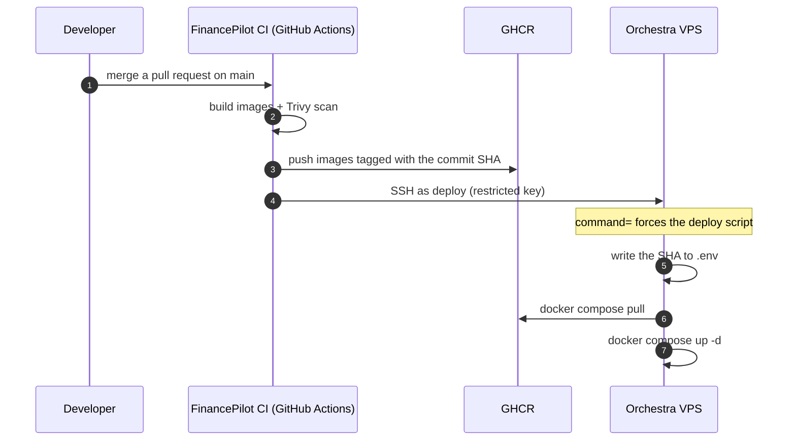

# ADR-0004 — Orchestra hosts FinancePilot, deployed by a restricted user

- **Date:** 2026-11-22
- **Status:** Accepted

## Context

FinancePilot, my CDA project, needs a real production server: my mentor asked for it instead of Railway (ADR-0003).
Orchestra already runs on that server and owns the reverse proxy, the domain and the monitoring.
GitHub Actions must deploy FinancePilot automatically after each merge on `main`, without ever logging in as root.

## Decision 1 — Who owns what

- Orchestra owns the server configuration: Nginx and the production Compose file for every service.
- FinancePilot only publishes its images to GHCR: `ghcr.io/victormetral/financepilot-api` and `ghcr.io/victormetral/financepilot-web`, tagged with the commit SHA.
- One domain for the application: `/` goes to the front end (port 8080), `/api` to the API (port 3000). Internal ports are never published on the host.

## Decision 2 — How the deploy user reaches Docker

| Option | Security | Effort |
|---|---|---|
| `deploy` in the `docker` group | Equivalent to root: a stolen key means a lost server | Very simple |
| Rootless Docker | Good | A second Docker daemon; ports below 1024 need extra setup |
| **SSH key restricted to one deploy script** ✅ | The key can only run the deployment | One small script to write |

**Choice:** a dedicated `deploy` user, without password, allowed to run only one root-owned script with `sudo`.
Its SSH key, used only by GitHub Actions, is limited with `command=` and `restrict` in `authorized_keys`: whatever the connection asks, SSH runs that script.
The script checks the requested commit SHA, writes it to the server's `.env`, then runs `docker compose pull` and `docker compose up -d`.
To roll back, the previous SHA is deployed again.

### Deployment flow

Sources:
- Docker group grants root-level privileges: https://docs.docker.com/engine/install/linux-postinstall/
- Rootless mode and its limits: https://docs.docker.com/engine/security/rootless/
- `command=` and `restrict` in `authorized_keys`: https://man.openbsd.org/sshd#AUTHORIZED_KEYS_FILE_FORMAT

## Consequences

- Positive: a stolen deploy key can only redeploy FinancePilot, not take over the server.
- Negative: one more script to write, test and keep in the repository.
- Next: create the `deploy` user on the VPS, then the deploy script and the production Compose file.
- Later: GHCR images are private by default; make them public (or add a read-only token) before the first pull.
